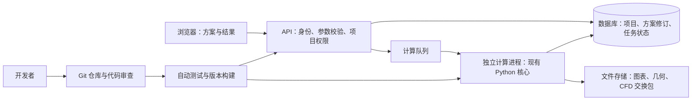

# 从桌面工作台到协作数字化平台

## 当前判断

截图错误来自指向原作者电脑绝对路径的 `.lnk`；复制的 `.venv` 还依赖原电脑的基础 Python。
这属于安装和交付问题。多人改完互相传文件，还会带来代码覆盖、版本不明、环境差异和无法回退。

当前软件使用 PySide6 桌面界面，计算模块已经有一定分离。
先建立可靠安装和代码协作，再分阶段网页化，比一次重写全部功能更容易保持结果一致。

## 两种“协作”分别解决

| 需求 | 实施方式 | 本次状态 |
| --- | --- | --- |
| 多人开发、审查代码、查历史、回退 | Git + 分支 + PR + 自动测试 | 已建立公开仓库 [liyunfei1994/lre-workbench](https://github.com/liyunfei1994/lre-workbench)，检查结果见仓库 Actions |
| 换电脑能运行 | 自动准备解释器、依赖约束、运行时功能检测 | 已实施，验证情况见本次验证记录 |
| 出问题能诊断 | 环境报告、版本指纹、源码包文件摘要 | 已实施 |
| 浏览器使用，无需各自安装 | 网页界面 + 后台 API + 计算任务服务 | 尚未实施 |
| 多人编辑同一方案和共享结果 | 数据库、修订记录、冲突检测、项目权限 | 尚未实施 |

## 推荐的目标结构

以上是目标架构，不是本次已部署的服务。推荐先在团队内网落地，
待账号、备份和运维方案稳定后再决定公网访问。

## 分阶段迁移

1. **统一开发和发布。** 使用本次安装器、依赖约束、Git 基线和 CI 配置。
   验收标准是新成员从干净源码完成安装和测试，修改经过审查后才进入主分支。
2. **提取无界面的计算服务接口。** 以 `core.EngineInputs` 和 `CycleResults` 为边界，
   复用 `cycle.py`、`gg_cycle.py` 与工程评估。输入、输出和错误必须可序列化。
   Qt 信号、绘图画布、桌面文件选择器不进入服务层。使用同一组案例对比桌面和服务结果。
3. **首个内网网页版本。** 先覆盖“方案创建 / 导入 → 设计点计算 → 状态 / 结果查看 → 导出”。
   可选择 React 或 Vue 前端、FastAPI 后端、PostgreSQL 数据库；
   长计算由独立进程执行，不能阻塞网页请求。任务需可取消、有超时、有资源上限。
4. **团队数据协作。** 保存不可变方案修订；提交编辑时携带 revision，冲突返回明确提示。
   每个任务记录提交人、输入快照、源码版本、依赖指纹、日志和结果。
   权限检查在服务端执行，数据库备份应定期做恢复演练。
5. **复杂页面和 CFD。** 逐步迁移参数扫描、几何和图表。
   CFD 通过受管理的计算节点和明确配置的适配器连接；许可证和求解器安装独立管理。
   不允许网页用户提交任意本机可执行路径或 Shell 命令。

技术选型是针对现有 Python 科学计算代码的建议，仍需结合团队人数、并发任务量、
服务器条件、数据归属和 CFD 软件来确定部署规模。

## 本次改造范围

本次聚焦现有程序的可安装性、可诊断性和团队开发交付基础。
保留现有计算模型和方案格式，没有改变物理公式、默认物性或求解容差。
没有把桌面界面伪装成网页，也没有上线公共服务。

## 依据

- [Python 官方 venv 文档](https://docs.python.org/3.14/library/venv.html)：虚拟环境不应视为可搬迁目录，应在目标机器重建。
- [GitHub 必需检查](https://docs.github.com/en/pull-requests/reference/status-checks)：可将 CI 检查作为受保护分支的合并条件。
- [uv 的 Python 管理](https://docs.astral.sh/uv/guides/install-python/)：可自动准备独立 Python；其分发来自 python-build-standalone。
