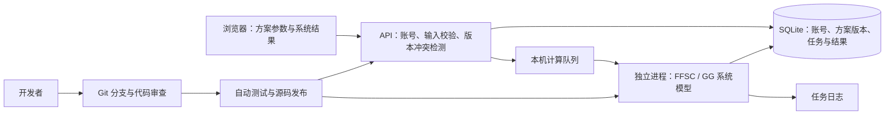

# 可重复使用火箭发动机数字化平台：系统仿真阶段

## 当前定位

本阶段聚焦发动机的**系统仿真与总体设计**：用统一的方案输入完成稳态设计点计算，
检查循环匹配、流量分配、压力关系、轴功率平衡和系统热力状态，并保存可追溯的计算结果。
网页继续采用已确定的三栏布局：功能导航、参数设置、分析结果。

网页功能按系统设计组织，参数表单突出系统输入及热边界假设，结果包括稳态性能分析、
节流稳态性能分析、发动机循环原理图、流路状态分析和部件性能分析。详细推力室设计、局部结构有限元、CFD、
材料库和三维几何交互不属于当前网页建设范围。桌面版已有代码与历史方案继续保留。

再生冷却的吸热和压降会影响循环闭合，因此仍属于系统模型。
当前阶段使用系统级冷却边界及已有集总模型，不把沿程详细冷却、壁温或局部强度校核
作为网页系统设计点的验证结论。数值收敛与系统约束通过分别展示。

“可重复使用”是平台的长期应用方向。当前已实现稳态设计点、节流准稳态扫描与若干瞬态研究单元；
完整发动机的启动、关机与再启动耦合、动态控制和复用寿命评估尚待建立，不能用单次稳态收敛或独立单元守恒通过替代这些验证。

## 已有能力与交付边界

| 能力 | 当前状态 |
| --- | --- |
| 本机网页工作台 | 已提供原生 HTML / CSS / JavaScript 三栏界面与 FastAPI 后端 |
| 稳态设计点 | 复用现有 Python FFSC / GG 循环核心，后台独立进程执行 |
| 节流稳态性能分析 | 从不可变设计记录建立主喷管喉部基准；独立任务与历史、性能曲线、逐点诊断和 CSV / SVG / JSON 导出 |
| 瞬态研究单元 | 热态局部扰动、单相供给网络、纯工质预冷充填与气相给定点火分别建模；适用域和来源独立保存 |
| 关机与再启动分析 | 三个独立单元：气相余气排出与给定第二热脉冲、纯工质 HEM 泄放/热浸/再充填、满液管网转子惰转/反流；连续状态、守恒审计、历史和导出，尚非整机耦合模型 |
| 推进剂组合 | 液氧/甲烷：FFSC、GG；液氧/煤油：正十二烷替代物、GG 单轴/并联双轴，指定冷却吸热量与压降 |
| 方案管理 | 创建、导入、导出、不可变版本、保存冲突检测 |
| 计算追溯 | 输入快照、计算记录、日志、环境指纹和结果导出 |
| 本机工作区协作 | 管理员与成员账号，共享项目、版本和任务 |
| 任务控制 | 单任务执行、排队、取消、超时和重启中断处理 |
| 网络访问 | 仅监听 `127.0.0.1`；尚未提供局域网或公网部署 |
| 团队代码协作 | Git 分支、Pull Request、自动测试与源码打包流程 |

同一电脑的多个浏览器会话可以验证共享工作区；两台电脑的实际访问验收仍待后续部署。
启动、停止、备份与账号限制见 [本机网页版说明](WEB_LOCAL.md)。
煤油替代物不代表真实 RP-1 或厂商实机标定；物性边界、部分气相物种高温外推和未覆盖现象见[推进剂模型说明](PROPELLANT_MODELS.md)。

## 当前结构

网页与桌面共用输入契约及显示单位；存储和求解使用 SI 单位。
网页表单只呈现本阶段适用参数，完整输入 JSON 保持原有方案兼容性。
历史结果保留原计算范围及原工程校核；按当前系统范围重新运行后，生成新的计算记录。

节流扫描固定主喷管喉部面积与膨胀比，反解各推力指令对应的室压；不把室压比例直接等同于推力比例。
来源设计记录不随草稿编辑改变，逐点保存数值收敛、喉部闭合和系统约束状态；取消保留已返回的工况，
缺失与失败点不插值。环境压力、整机 O/F、效率和压降假设沿用来源记录，GG 排气喷管仍按工况重算。
当前未接入完整泵／涡轮特性图、执行机构调节规律与深节流喷管分离模型，因此通过的扫描点仅表示
现有模型内的计算结果，不等于完整固定硬件的非设计工况验证，也不能替代最低节流能力试验。

## 接下来的建设顺序

1. **设计点与循环一致性。** 对 FFSC / GG 参考工况逐项核对输入、物性、求解状态与输出，
   明确参考值、模型假设和适用范围。新增模型变更必须有可复现的对照案例。
2. **系统平衡与诊断。** 改善流量、压力、轴功率和热量关系的展示，清晰区分数值失败、
   约束不满足和缺失数据，使用户能够从结果定位到参数与模型假设。
3. **系统参数研究。** 节流稳态性能分析已恢复；继续核对不同循环和工质的适用范围，
   逐步引入有依据的非设计工况特性模型。参数敏感性与方案对比尚待建设。
4. **协作部署。** 明确服务器、访问范围和备份恢复方式，再添加 HTTPS 与网络访问，
   完成两台电脑提交、排队、查看、冲突处理及恢复验收。
5. **动态与复用研究。** 已建立零维热态小扰动、单相供给网络、纯工质预冷充填、气相给定点火等研究入口。新增关机与再启动研究，分别延续气相容腔、HEM 气液库存或满液轴系的状态，研究关阀、泄放、热浸、转子惰转、反流及再次供给/驱动；三类研究尚未耦合，外给力矩和第二热脉冲均是边界输入。后续将单元与完整供给网络和驱动轴耦合，补充实测特性、不凝气体吹除、非平衡沸腾、液体喷注/雾化/汽化与控制器，再以适用推进剂和工况的试验建立点火成功、延迟、熄火及完整启动、关机、再启动验证依据。见 [关机与再启动模型](SHUTDOWN_RESTART_MODEL.md) 和 [文献证据](SHUTDOWN_RESTART_EVIDENCE.md)。
   这些能力需要独立的需求、实验或文献数据及验收标准。

详细部件设计、FEM 和 CFD 的网页化不列入本阶段任务。已有桌面 CFD 交换接口可继续
作为历史功能使用，其说明见 [CFD 接口文档](CFD_INTERFACE.md)；它不代表当前网页具备
外部求解器调用、详细流场分析或结构分析能力。

## 验收重点

- 在同一方案与物性条件下，网页系统设计点与对应循环核心得到一致的总体性能和状态点。
- 明确记录计算范围；系统约束结论只覆盖参与本次计算的系统级检查。
- 节流扫描可追溯到原设计记录；数值收敛、主喷管喉部闭合和系统约束分别验收，不把计算完成当作可用节流范围验证。
- 关机与再启动单元在事件切换处保持物理状态连续，逐项核对质量、能量或转子动能账目；适用域退出保留有效结果和未到达事件，不把外给驱动响应标为自主再启动成功。
- 修改输入、保存版本、提交任务和查看历史结果之间的对应关系可见，不用旧结果代表新草稿。
- 保存冲突、断线、取消、超时和重启不会覆盖方案历史或伪造成功结果。
- 页面只提供可用的当前功能入口，测试数据与用户工作区分开。
